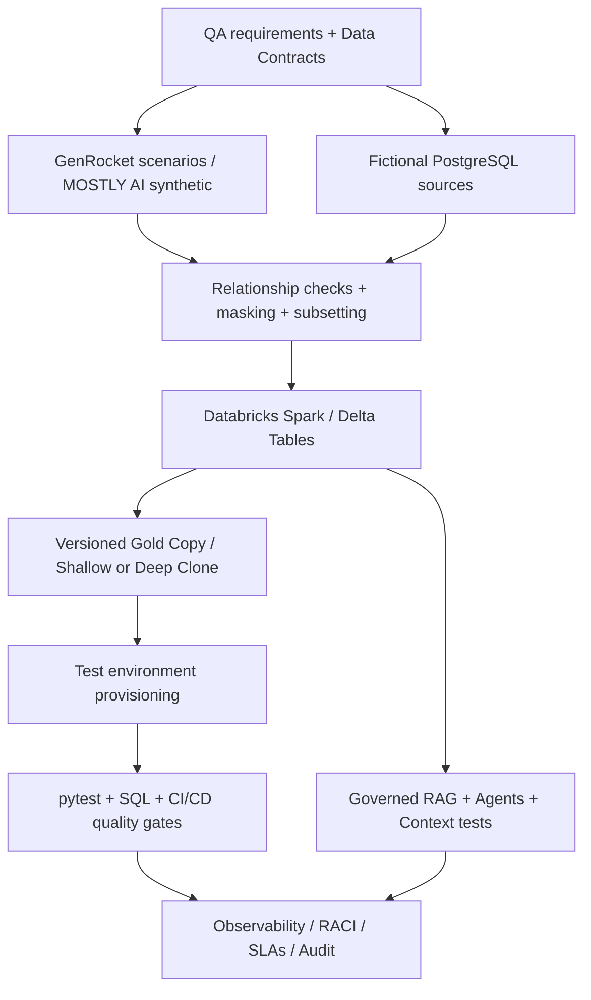

# Bigger Picture / 系統大架構

## Role: what TDM does
Test Data Management (TDM) supplies *safe, representative, versioned and repeatable* data to QA, developers and CI/CD systems. Its lifecycle is **discover → generate/extract → classify/mask/subset → provision → refresh/version/Gold Copy → validate/govern/retire**.

**Why you learn this:** Your Python, SQL and ETL experience is a strong starting point. New requirements include TDM strategy, PK/FK-safe subsetting, privacy, reusable test datasets, refresh SLAs, Gold Copies and tool selection. Databricks powers lakehouse orchestration, not every responsibility of a full TDM product.

## Important differences
- **GenRocket:** study actual Domains, Generators, Receivers and Scenarios. Target hands-on depth; access may be required.
- **MOSTLY AI:** hands-on synthetic statistical data SDK (train/generate/evaluate fictional data); not automatically interchangeable with GenRocket.
- **Delphix:** assess virtualized environments, data compliance, fast delivery/refresh.
- **Informatica TDM:** understand discovery, masking/subsetting plans, deployment and governance.
- **Broadcom/CA TDM:** understand generation and shared QA data reservation / provisioning.
- **Databricks:** Delta, PySpark, Lakeflow, Unity Catalog, clones, jobs and AI features.
- **Gold Copy (TDM):** known-good test-data snapshot; **not** the Gold layer of Medallion.
- **Privacy:** pseudonymized data can remain personal data; never use real production records in this public repo.

## Enterprise strategy deliverable
Executive summary; data requirements & applications; classification; source selection; relational graph/subsetting; masking; generation tools; provisioning; refresh/rollback; environment ownership; RACI; SLA/KPIs; incident response; storage and compute cost; vendor scorecard. KPI examples: time-to-provision, refresh pass rate, test coverage, privacy incidents, orphan FK rate and restoration time.
